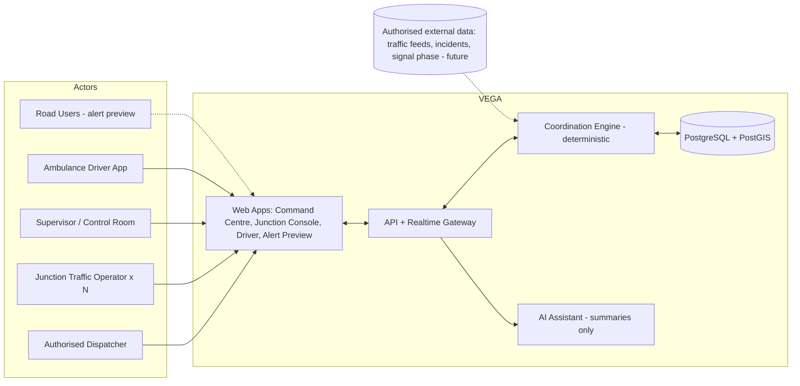
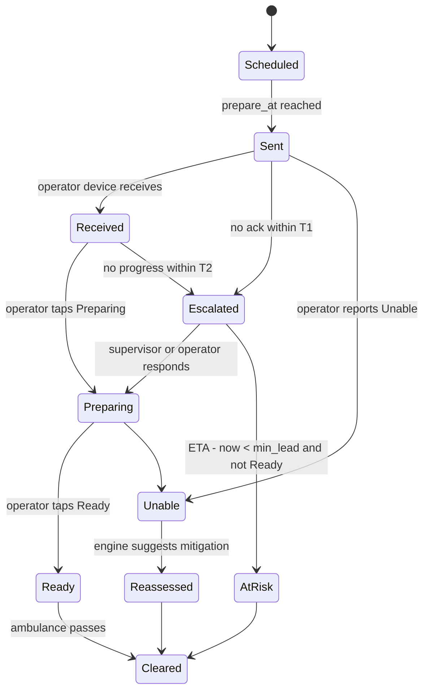

# VEGA — Architecture & Prototype Design

**Emergency Mobility Intelligence Platform** · Team Devora · SEVA Innovation Challenge (Infrastructure & Mobility → Automation in Traffic Management)
**Tagline:** *Every Second Matters. Every Road Responds.*

> **Prototype disclaimer:** every vehicle, junction, operator, timestamp and metric in the prototype is **simulated demo data** and is labelled as such inside the UI. No real-world performance claims are made.

---

## 1. What VEGA Is (one paragraph)

VEGA is not an ambulance tracker. It coordinates the **people and junctions** along an ambulance's route. For each upcoming junction it answers four questions: *Which junction must act next? Who is responsible? When must they act? Has it been done?* It predicts preparation times from ETA, sends junction-specific tasks, tracks acknowledgement and readiness, escalates when someone does not respond, and re-plans when a roadblock appears. Signal control always stays with authorised traffic personnel. VEGA only recommends and coordinates.

### Why this matters (research context)
- Ambulance response times in large Indian cities are commonly reported in the 25–30 minute range, and congestion is a major cause of lost "golden hour" time.
- Existing approaches in India are mostly manual "green corridors" arranged by traffic police, or hardware-based signal pre-emption (e.g. the Bengaluru pilot where a device turns a signal green as an ambulance approaches). Reports also note that only a small share of urban signals can support modern pre-emption.
- Academic IoT pre-emption systems mostly focus on turning the signal green automatically. They largely ignore the **human coordination layer**: who was told, did they acknowledge, and what happens if they didn't.
- **VEGA's gap:** a predictive, accountable, human-in-the-loop coordination layer that works even where signals cannot be remotely controlled.

---

## 2. System Context



---

## 3. Target Architecture (full product)

| Layer | Technology | Responsibility |
|---|---|---|
| Frontend | Next.js, React, TypeScript, Tailwind CSS, Lucide, MapLibre GL | Command centre, junction console, driver view, alert preview |
| Realtime | WebSockets | Push junction status, ETA updates, alerts |
| Backend | Python, FastAPI | REST APIs, auth, trip lifecycle, event ingestion |
| **Coordination Engine** | Python rule engine (deterministic) | ETA calculation, prep scheduling, escalation, safety validation |
| Data | PostgreSQL + PostGIS | Users, trips, junctions, tasks, audit events, geometry |
| AI layer | LLM API (optional) | Grounded trip summaries and explanations only |
| Simulation | In-app simulator (prototype) → SUMO + TraCI (advanced) | Baseline vs VEGA comparison |
| Deployment | Docker Compose | Repeatable deploys |

**Safety principle:** safety-critical logic is deterministic and rule-based. AI never controls signals or makes safety decisions.

### Backend service boundaries
```
api/
  routers/    trips, junctions, tasks, events, simulation
  engine/     eta.py, scheduler.py, escalation.py, reroute.py, safety.py
  models/     Trip, Junction, Operator, Task, Event
  realtime/   websocket hub
  ai/         summary.py (grounded in event log)
```

---

## 4. Coordination Engine — Core Logic

### 4.1 Inputs
Ambulance position and speed, planned route (ordered junction list with distance along route), per-junction **preparation lead time**, operator assignment, incidents/roadblocks, current time.

### 4.2 ETA per junction
```
eta(j) = now + remaining_distance_to(j) / smoothed_speed
smoothed_speed = clamp(EMA(speed), min_speed, max_speed)
```

### 4.3 Preparation scheduling
```
lead(j)        = base_lead + congestion_factor(j) + pedestrian_factor(j)
prepare_at(j)  = eta(j) - lead(j)
```
A task is issued to the junction operator when `now >= prepare_at(j) - dispatch_margin`. Tasks are **re-computed every tick** because ETA changes.

### 4.4 Junction task state machine


Key rule: **a sent alert never equals ready.** Only an explicit `Ready` (or verified signal-phase data when integrated) marks readiness. Stale data is shown as `Uncertain`.

### 4.5 Escalation ladder
| Level | Trigger | Action |
|---|---|---|
| L0 | Task issued | Notify assigned operator |
| L1 | No acknowledgement within ~20 s (configurable) | Re-alert + audible/visual flag on command centre |
| L2 | No acknowledgement within ~40 s | Notify supervisor and nearest backup operator |
| L3 | Not Ready and `ETA - now < min_lead` | Mark **At Risk**, advise driver and alert-preview channel |

### 4.6 Exception & reroute
- **Roadblock reported** → mark segment blocked → compute alternate route from graph (Dijkstra/A* with blocked edges removed) → show side-by-side comparison (ETA, junctions affected) → dispatcher approves → affected junctions get **updated or cancelled** tasks; newly involved junctions get new tasks.
- **Missing/outdated data** → UI shows `Uncertain` badge; engine never assumes readiness.

### 4.7 Decision support (human-reviewed)
For an upcoming junction, show context (queue length, pedestrian phase, conflicting movements, current signal phase if known) and a **recommendation card** (e.g. "Hold cross traffic 12 s before ETA; pedestrian phase ends in 8 s"). The operator accepts, edits or rejects. Every action is audit-logged.

### 4.8 Audit
Every event records `timestamp, actor, trip_id, junction_id, type, payload`. The trip review is generated from this log.

---

## 5. Data Model (core entities)

```
User        id, name, role[dispatcher|operator|supervisor|driver], junction_id?
Junction    id, name, lat, lng, lead_time_s, signal_type, operator_id, backup_id
Segment     id, from_junction, to_junction, length_m, blocked, avg_speed
Trip        id, vehicle_id, origin, destination, status, route[], started_at, ended_at
Task        id, trip_id, junction_id, prepare_at, eta, status, escalation_level
Event       id, trip_id, ts, actor, type, payload, simulated(bool)
Incident    id, segment_id, type, reported_by, ts, active
Metric      trip_id, scenario[baseline|vega|failure], journey_s, wait_by_junction, ack_avg_s, unresolved
```

---

## 6. Prototype Architecture (hackathon build)

The prototype must look and behave like the real product while being **100% reliable on stage**. It therefore runs a **client-side deterministic simulation** that mirrors the real engine's interfaces.

```
Next.js app (TypeScript, Tailwind, MapLibre, Zustand, Framer Motion, Recharts)
│
├── app/
│   ├── (command)/command-centre        main dashboard
│   ├── (command)/trips/new             emergency trip activation
│   ├── junction/[id]                   junction operator console
│   ├── driver                          ambulance driver view
│   ├── alerts-preview                  road-user alert preview
│   ├── simulation                      baseline vs VEGA vs failure
│   └── review/[tripId]                 trip review
│
├── lib/
│   ├── engine/                         ← mirrors Python engine (pure TS functions)
│   │   ├── eta.ts   scheduler.ts   escalation.ts   reroute.ts   safety.ts
│   ├── sim/                            ← scripted clock, ambulance mover, scripted operator behaviours
│   ├── data/                           ← fake Pune network, operators, scenarios (labelled SIMULATED)
│   ├── store/                          ← Zustand stores (trip, junctions, events, clock)
│   └── types.ts
│
└── components/                         ← MapView, JunctionRail, TaskCard, Timeline, KpiStrip, ...
```

**Cross-tab realism:** use `BroadcastChannel` so a Junction Console in a second window/tab updates the Command Centre live. This makes the demo convincing with no backend.

**Optional upgrade path:** `lib/engine/*` has the same function signatures as the FastAPI engine, so the Python backend can replace it without UI changes.

### Prototype-to-product mapping
| Product component | Prototype stand-in |
|---|---|
| FastAPI + WebSockets | Zustand store + BroadcastChannel |
| PostgreSQL/PostGIS | Static TypeScript JSON fixtures |
| Live GPS | Scripted ambulance moving along a polyline |
| Operator devices | Junction Console pages with scripted or manual responses |
| SUMO | Pre-scripted scenario runner (3 scenarios) |
| LLM summaries | Template-based "AI Summary" grounded in the event log (optionally real LLM) |

---

## 7. Demo Scenario (fake data, realistic feel)

**Setting:** a simulated city corridor inspired by Pune. Names are illustrative; the UI states "Simulated network".

| # | Junction | Operator (fake) | Lead time |
|---|---|---|---|
| J1 | Deccan Gymkhana Chowk | Insp. R. Kulkarni | 90 s |
| J2 | Sambhaji Bridge Junction | SI A. Deshmukh | 100 s |
| J3 | Alka Talkies Chowk | PSI S. Pawar | 110 s |
| J4 | Nal Stop Junction | HC M. Jadhav | 90 s |
| J5 | Karve Road Signal | PSI N. Bhosale | 80 s |

**Trip:** Ambulance **MH-12-AMB-108 (simulated)** from *Accident site – Deccan* to *Hospital – Karve Nagar (simulated)*, patient priority **Critical**.

**Scripted story (≈ 3–4 min demo):**
1. Dispatcher activates trip → route + 5 junctions + ETAs appear.
2. J1 is acknowledged in 6 s and marked Ready.
3. J2 operator is slow → **L1 escalation**, then L2 → supervisor responds.
4. J3 reports a **roadblock** (accident on segment) → reroute proposal → dispatcher approves → tasks updated.
5. J4 shows **decision support** (pedestrian phase) → operator accepts recommendation.
6. Ambulance clears all junctions → **Trip Review** shows timeline, acknowledgements, unresolved alerts, AI summary.

---

## 8. UI / UX Design

### 8.1 Design language
Dark "mission control" aesthetic, calm and precise. Glass panels, thin borders, subtle glow on the ambulance and active junction, monospace for IDs and timers.

| Token | Value | Use |
|---|---|---|
| `--bg` | `#0A1222` | App background |
| `--panel` | `#12203A` | Cards and panels |
| `--panel-2` | `#172A4A` | Raised/hover panels |
| `--border` | `rgba(255,255,255,0.08)` | Dividers |
| `--accent` | `#2DD4BF` | Primary accent, Ready, route |
| `--highlight` | `#FFBE5C` | Warnings, decision support |
| `--danger` | `#F87171` | Blocked, escalated, At Risk |
| `--info` | `#60A5FA` | Preparing, received |
| `--text` | `#E6EEF8` | Primary text |
| `--muted` | `#8FA3BF` | Secondary text |

**Typography:** Inter (UI), JetBrains Mono (timers, IDs). **Icons:** Lucide. **Radius:** 14–16 px. **Motion:** Framer Motion, 150–250 ms, no gratuitous animation.

**Status colours:** Scheduled = grey · Sent = info blue · Received/Preparing = blue pulse · **Ready = teal** · Escalated = amber pulse · Unable/At Risk/Blocked = red · Uncertain = dashed grey outline · Cleared = dimmed with check.

### 8.2 Screen 1 — Command Centre (hero screen)

```
┌──────────────────────────────────────────────────────────────────────────────────┐
│ ◉ VEGA  Emergency Mobility        [SIMULATED DATA]   Trip #E-2041  ● LIVE  14:32 │
├───────────────┬───────────────────────────────────────────────┬──────────────────┤
│ ACTIVE TRIP   │                                               │ UPCOMING JUNCTIONS│
│ MH-12-AMB-108 │                                               │ ▸ J2 Sambhaji Br. │
│ Critical      │            DARK MAP (MapLibre)                │   ETA 01:12       │
│ ETA dest 6:40 │   glowing route polyline, pulsing ambulance,  │   ⚠ Escalated L1  │
│ Speed 48 km/h │   junction nodes coloured by readiness,       │ ▸ J3 Alka Talkies │
│               │   blocked segment in red hatch                │   ETA 02:05       │
│ KPI STRIP     │                                               │   ○ Sent          │
│ Ready 1/5     │                                               │ ▸ J4 Nal Stop     │
│ At risk 0     │   [Reroute proposal card overlays here]       │ ▸ J5 Karve Rd     │
│ Avg ack 9.4s  │                                               │                   │
├───────────────┴───────────────────────────────────────────────┴──────────────────┤
│ EVENT TIMELINE  14:31:02 Trip activated · 14:31:08 J1 task sent · 14:31:14 J1 Ready…│
└──────────────────────────────────────────────────────────────────────────────────┘
```
Interactions: click a junction → slide-over with task details, operator, ETA countdown, escalation history, decision-support context. Floating **Report Roadblock** and **Simulation Controls** (play / pause / speed 1x–8x / reset).

### 8.3 Screen 2 — Emergency Trip Activation
Stepper: Authorisation (role badge) → Vehicle & patient priority → Origin/Destination (map pick or preset) → Route preview with junction list and ETAs → **Activate**. The route preview animates drawing on the map.

### 8.4 Screen 3 — Junction Operator Console (mobile-first)
Large, glanceable, one-hand use. Shows: junction name, **big ETA countdown ring**, assigned task, 4 large buttons (**Received · Preparing · Ready · Unable to Prepare**), junction-specific alerts, context chips (queue, pedestrians), and the decision-support recommendation card with Accept / Modify / Reject. Includes a "message to control room" quick reply.

### 8.5 Screen 4 — Exception & Reroute
Roadblock report sheet (segment, type: accident/congestion/closure, note). Then a **side-by-side route comparison**: original vs alternate (ETA delta, junctions added/removed, risk). Dispatcher approves → animated update of affected junction cards (Updated / Cancelled / New).

### 8.6 Screen 5 — Driver View
Minimal, high-contrast: next junction name, countdown, readiness state (Ready / Preparing / Unconfirmed), route change alerts, large text.

### 8.7 Screen 6 — Road-User Alert Preview
Phone mockup showing a participating-app alert: "Emergency vehicle approaching in ~90 s on Karve Road — please move left." Labelled **preview**.

### 8.8 Screen 7 — Simulation & Benchmark
Three scenario cards (Baseline · VEGA-assisted · Failure), run buttons, animated mini-maps, and charts (journey time, per-junction wait, ack time, unresolved alerts). Values are generated from the scripted sim and carry a clear **"Simulated result — not a real-world measurement"** banner. No percentage-improvement claims are presented as proven.

### 8.9 Screen 8 — Trip Review
Journey summary, junction-by-junction table (ETA vs actual, ack time, status), full event timeline, unresolved alerts list, grounded **AI Summary** panel (each sentence links to its source event), Export PDF button (optional).

### 8.10 Global UI components
Top bar with role switcher (Dispatcher / Operator / Supervisor), notification bell, simulation clock; toast stack for escalations; keyboard shortcuts; skeleton loaders; responsive down to tablet for the command centre and phone for the junction console.

---

## 9. Safety, Security & Reliability

- Role-based access: only authorised dispatchers activate trips.
- VEGA never actuates signals; operators remain in control.
- Missing/stale data shows **Uncertain**, never "Ready".
- Alert sent ≠ junction ready.
- All events timestamped and audit-logged.
- Simulated information always labelled as simulated.
- Route changes are communicated to every affected operator.

---

## 10. Roadmap
| Phase | Scope |
|---|---|
| 1 | Command centre, trip creation, route, moving ambulance, junction sequence, timeline |
| 2 | Predictive preparation, acknowledgements, readiness, escalation |
| 3 | Roadblock reporting, alternate routing, updated tasks |
| 4 | Decision support, safety checks |
| 5 | Simulation, baseline comparison, metrics, trip review |
| 6 | FastAPI + PostGIS backend, SUMO, authorised data integrations |

---

## 11. Demo Checklist
- [ ] Runs offline except map tiles (provide fallback plain dark grid if tiles fail)
- [ ] One-click **Reset demo**
- [ ] Simulation speed control
- [ ] "SIMULATED DATA" badge always visible
- [ ] Second window for Junction Console works via BroadcastChannel
- [ ] No fabricated partnerships, performance numbers or deployment claims